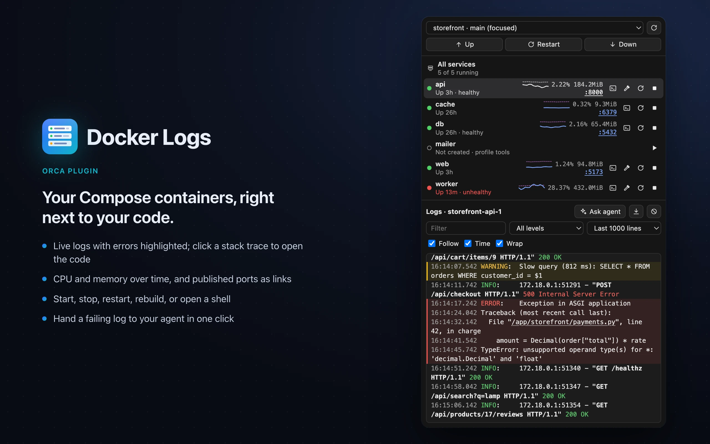

# Docker Logs

An Orca sidebar panel for the Docker Compose containers of the focused project: state, CPU and
memory over time, ports, start / stop / restart / rebuild, a shell, and a live log with error
highlighting whose stack traces open the code, and that you can hand to your agent in one click.

**Catalog listing:** [Docker Logs on Orca](https://www.onorca.dev/plugins/eskono/orca-docker-logs).
It runs its own worker (it calls the `docker` CLI, opens terminals and starts agents), so Orca
asks you to approve full access.



## What it does

- **Services from the compose files.** The worker asks `docker compose config` in the workspace
  folder, so Compose picks the files the way it does in a terminal (`compose.yaml` /
  `docker-compose.yml`, their `.override`, `COMPOSE_FILE` from `.env`). Services of every
  profile are listed; one that never ran shows its profile and starts with it. **Compose settings**
  lists configs from project folders, including nested paths such as `.docker/local/dev.yml`,
  and lets you select their profiles for project commands before applying the settings. Select the base file
  first, then any overrides; their order is shown and can be edited in the path field. Projects
  with only nested configs also appear in the project picker. You can still enter custom paths
  (one workspace-relative path per line) and profile names manually. Settings are
  checked before saving and belong to that workspace. Custom files keep the workspace's `.env`
  when present, unless `COMPOSE_ENV_FILES` or `COMPOSE_DISABLE_ENV_FILE` overrides dotenv use.
  Build/bind paths still resolve from the first Compose file. Empty fields restore Compose defaults.
- **Environment and effective profiles.** Choose an environment file, including nested
  `.env.dev` / `.env.prod` files, or keep automatic dotenv behavior. **From environment** uses
  `COMPOSE_PROFILES` resolved by Compose; **Choose profiles** overrides the service selection,
  and an empty manual selection enables only base services. Profile choices do not rewrite the
  `.env` variable used for interpolation inside YAML. The preview shows environment profiles,
  effective profiles and enabled services; the project summary separately shows actual running
  services and those outside the selected set. Running containers are not treated as proof of
  which profiles were originally used to start them.
  Up, Restart and Down use the same profile set, env file and project name. Terminal actions
  preserve the worker's Compose control variables even when a terminal has different exports.
  Explicit per-container actions still target the container/service you clicked.
- **State at a glance.** A dot per container (running, starting, unhealthy, crashed), uptime,
  CPU and memory from `docker stats` with a small chart of the last minutes (line: CPU, dashes:
  memory). Click a published port to copy its address; the adjacent arrow opens recognized web
  ports using HTTP or HTTPS. Database ports are addresses to copy. Hover a row for the last
  health check output, the memory limit and the CPU and memory range.
- **Diagnostics.** Expand the selected container's diagnostics to see its exit code, OOM-kill
  flag, restart count, runtime error, last health check and start/finish times. The Docker context
  is shown above the services, with the endpoint in its tooltip and a label for remote daemons.
- **The project follows Orca's focus.** The picker at the top lists every local workspace with a
  compose file or saved configuration, to look at another one. The focused local workspace is
  also listed when it has no automatically discovered file, so custom files can be configured.
  Drag the divider below the services, or focus it and use the arrow keys, to resize the list.
- **Actions.** Per container: shell (`docker exec -it … bash`, or `sh`), rebuild
  (`compose up -d --build`), restart, stop, start. For the project: Up, Restart and Down (Down
  asks for a second click). Commands that may build or pull (Up, rebuild, creating a container)
  run in a new Orca terminal tab so you see their output.
- **Operation progress.** Recent operations show running, completed, failed or unconfirmed
  results and their latest output. Expand an operation or reopen its terminal for build/pull
  details. Conflicting commands on the same service/project are blocked while running.
  Commands in terminals continue through panel reloads; their completion is checked from their
  exit marker. The plugin reads only terminals it created for tracked operations. This needs
  the new `terminal:read` grant when updating from 0.4.
- **Logs.** One container or **All services** interleaved by time and tagged by container, with
  ANSI colours. Errors and warnings are highlighted in plain, logfmt and JSON logs, stack traces
  included; the level picker shows only them. Periods: the last 1000 lines, 5 or 15 minutes, an
  hour, or since the container started. Filter, timestamps, wrap, and **Save** to a file.
  Programs that print no colours under Docker still get their level word coloured. **Copy** uses
  your selected log text, or all visible lines when nothing is selected. Polling keeps unchanged
  line elements, so new messages do not discard text selection.
- **Combined logs and saved views.** Check services to combine their logs, including every
  replica of those services. Save a named view with its services, text filter, search, level,
  period, grouping, JSON fields, wrap and timestamps. Views belong to their workspace and can
  be restored or deleted from the view picker. Choose the blank entry to save a new view.
- **Find without filtering.** The separate search highlights literal, case-insensitive matches
  while keeping surrounding lines visible. Use Enter/Shift+Enter, F3/Shift+F3 or the arrows
  to navigate; Ctrl/Cmd+F focuses search and Escape clears it. Matches inside collapsed traces
  open the trace when visited. Search highlights at most 1000 matches in the loaded display.
- **Structured logs and repeated errors.** **JSON fields** expands object fields, including nested
  fields. Filter with `trace_id=abc`, `request.id=42`, or `trace_id="two words"`; multiple terms
  are combined. Click a request/trace/correlation ID in the field view to filter by it. **Group
  errors** collapses identical error/warning records from the same container, keeps a representative
  stack trace and shows a repetition count. Save and Copy without a selection still export the
  original visible lines, including repetitions.
- **Stack traces open the code.** Paths in Python, Node, Go, Ruby and PHP traces that belong to
  the project are links: a click opens the file at that line in Orca's editor. Container paths
  map to the project through the service's bind mounts (`./app:/srv/app`), or, for code copied
  into the image, by the longest part of the path that exists in the project; library frames
  stay plain text. Web addresses in the log are links too.
  Multiline traces collapse into expandable records: project frames are highlighted, known
  library frames are dimmed, and frame order is preserved. Save/Copy still use complete text.
  Move between error records with the error arrows or Alt+Up/Alt+Down outside text fields.
- **Container events.** A persistent timeline records observed starts, stops, OOM kills,
  restarts and health changes, including events of containers removed during a rebuild.
  Click an event to read that container's logs for ±30 seconds, with Follow paused; **Live logs**
  returns to the tail. Removed containers retain their events but Docker no longer exposes
  their logs. History is separated by workspace, Compose project and Docker target.
- **Ask agent** starts the agent set in Settings (Claude by default) in the project's workspace
  with the latest visible error/warning and surrounding unfiltered lines from that container.
  The worker adds fresh container diagnostics, the Docker context and Compose settings, and asks
  the agent to find the cause. Context is bounded to 300 log lines / 24,000 characters; the prompt
  reports the included count and treats log content as evidence rather than instructions.
- **Clear** hides what was logged so far (it remembers the time and asks `docker logs --since`);
  Docker's log is not touched, so **Show all** brings it back.
- **Status bar.** `running/total` for the focused project, red when a container crashed, keeps
  restarting or turns unhealthy, with a desktop notification when that happens (Settings can turn
  notifications off). OOM kills and unexpected increases in restart count are included.

## Log history and limits

Logs are polled every two seconds while Follow is enabled and the panel is visible. Later polls
use a cursor per container, including Docker's nanoseconds; overlapping boundary lines are
deduplicated without removing genuine repeated lines. Short Docker commands share a four-process budget.
Event streams have a separate two-stream limit, expire after 30 seconds without a watcher and
reconnect after daemon failures. The focused project is watched by the status worker even with
the panel closed. Docker's retained events are read on reconnect; this is observed history,
not a complete audit trail while Orca is stopped.

The tail view retains the newest 1000 lines across the selected containers. Time windows and
Since start initially read up to 5000 lines per container; subsequent polls use the same cap for
new data. The panel retains up to 10,000 lines / approximately 1.8 million characters for those
views. Replies stay below the IPC size budget. **Partial history** identifies omitted lines due
to tail, reply or panel-buffer limits, including when a filter is active; it is not a full-history
export. If one container disappears during rebuild, its error appears alongside the other logs.
Event history retains up to 200 events / 48 KB per target. Operation history keeps up to ten
operations / 48 KB per workspace, with at most four concurrent commands and a bounded output
tail. Saved views are limited to 20 / 48 KB per workspace. These histories use plugin-owned storage.

Config discovery recognizes standard Compose filenames and YAML files with top-level `services`
or `include` keys. It skips dependency/metadata folders and symlinks, and scans up to 20,000
entries / 1000 directories, returning at most 200 configs. **Rescan folders** refreshes the list;
paths can also be entered manually if a scan reaches its limit or a custom file is not recognized.
Env-file discovery returns filenames only. Environment metadata is resolved by Compose, including
on Compose 2.17; temporary interpolation probes contain references, not resolved application
values, and are removed after use. Application environment values are not included in profile
metadata sent to the panel. Root configs, their automatic overrides and root `.env` keep the
existing discovery behavior; selecting a nested file does not merge root overrides into it.

## Settings

| Setting                       | Default  | What it does                                               |
| ----------------------------- | -------- | ---------------------------------------------------------- |
| Docker CLI path               | (empty)  | Where `docker` is, when it is not found on its own         |
| Agent for “Ask agent”         | `claude` | Agent Orca starts with the log, such as `codex`            |
| Notify when a container fails | on       | Desktop notifications from the status bar watcher          |

## Notes

- **Docker binary.** Orca opened from the Dock gives plugins a short `PATH`, so the worker also
  looks in `/usr/local/bin`, `/opt/homebrew/bin`, Docker Desktop, OrbStack and Rancher Desktop.
- **The `orca` CLI.** Orca's plugin API gives the focused workspace's name and branch, not its
  folder, opens terminals in the background and opens files without a line. The worker uses the
  `orca` CLI for those: `terminal list` to tell apart workspaces that share a name and branch,
  `terminal switch` to show the terminals it opens, and `file open --line` for stack traces.
- **Local workspaces.** Workspaces on SSH hosts are not listed. Docker uses the worker's effective
  context or `DOCKER_HOST`, which can point to a remote daemon. New terminals are pinned to that
  same target. Remote containers need bind-mount/source paths meaningful on the daemon host.
- **Safety.** The worker acts only in folders Orca lists as local workspaces, checks every
  service name, container id and time it receives, verifies container project labels and working
  directory before operations, never runs a shell for its own commands, and quotes what it types
  into terminals. Compose actions are refused if another workspace uses the same project name;
  assign a unique `name:` or `COMPOSE_PROJECT_NAME` to those stacks. Custom Compose paths must
  resolve to files inside the workspace, including through symlinks. Log text is rendered as text.

## Layout

| File                 | What it does                                                               |
| -------------------- | -------------------------------------------------------------------------- |
| `orca-plugin.json`   | Manifest: panel, worker, status bar item, settings, capabilities, images   |
| `src/worker.ts`      | Worker: panel requests, terminals, agent, status bar and notifications     |
| `src/docker.ts`      | Finds and runs docker; parses `compose config`, `inspect`, `stats`, logs   |
| `src/status.ts`      | Status bar summary and which container problems notify                     |
| `src/compose.ts`     | Compose command arguments and validation of workspace configuration        |
| `src/compose-discovery.ts` | Bounded discovery of Compose configs in project folders               |
| `src/compose-environment.ts` | Compose-resolved environment/profile metadata across supported CLI versions |
| `src/diagnostics.ts` | Container diagnostics shared by the panel and agent hand-off               |
| `src/operations.ts`  | Tracked command output, exit status and persisted operation history         |
| `src/events.ts`      | Bounded Docker event streams, reconnects and persisted timelines            |
| `src/views.ts`       | Validation and bounds for workspace saved views                            |
| `src/async.ts`       | Shared Docker process concurrency budget                                   |
| `src/sources.ts`     | Which project file a stack trace path in a container is                    |
| `src/orca-cli.ts`    | The `orca` CLI calls: terminal lookup and switch, opening a file at a line |
| `src/workspaces.ts`  | Local workspaces with compose files; which one is focused                  |
| `src/protocol.ts`    | Request and answer types shared by the panel and the worker                |
| `panel/index.html`   | Panel markup and styles (Orca theme variables)                             |
| `panel/main.ts`      | Panel logic: project, containers, actions, logs                            |
| `panel/requests.ts`  | Request ownership and cancellation across navigation and Clear             |
| `panel/log-buffer.ts`| Incremental log history, overlap deduplication and retention                |
| `panel/log-model.ts` | Structured fields, filtering, grouping and incident context                |
| `panel/log-view.ts`  | DOM reconciliation that preserves existing log lines                       |
| `panel/search.ts`    | Literal highlights across ANSI spans/links and match navigation             |
| `panel/traces.ts`    | Project/library frame classification without reordering traces              |
| `panel/operations-view.ts` | Operation status, output and terminal access                         |
| `panel/ports.ts`     | Port addresses and recognized HTTP/HTTPS links                              |
| `panel/levels.ts`    | Error and warning detection, level words to colour                         |
| `panel/links.ts`     | Web addresses and stack trace locations in log lines                       |
| `panel/sparkline.ts` | `docker stats` numbers and chart points                                    |
| `panel/ansi.ts`      | ANSI colour codes to styled segments                                       |
| `panel/icons.ts`     | The panel's icons                                                          |

## Develop

Use Node 24.15+ (or Node 26+) for development; the plugin itself keeps no runtime npm dependencies.

```sh
npm ci
npm run check                     # source/manifest integrity, strict TypeScript and tests
orca plugin validate . --json     # official Orca manifest validation
orca plugin test . --json         # same tests, using Orca's actual worker host testing kit
orca plugin dev watch . --json    # load into Orca, stream logs and reloads
```

CI runs the portable checks on Linux and macOS. Worker tests use a fake Docker and Orca CLI;
DOM tests run the bundled panel in jsdom and exercise navigation races, Clear, selection,
incremental updates, diagnostics, settings, structured logs, search, traces, events and saved views. No test changes real containers
or starts an agent in these portable/Orca suites. `npm test` maps `orca/testing` to `test/host.ts`, a small stand-in; the Orca
command uses its own kit and checks the actual host API contract as well.

For an opt-in live integration check, run `npm run test:docker`. It uses a cached standard Linux
shell image (or `DOCKER_LOGS_TEST_IMAGE`), creates a uniquely named temporary Compose stack and a
foreign-container fixture, and removes those fixtures in `finally`. It never pulls an image.
This checks nested `COMPOSE_FILE`, project ownership, profiles, logs, stats, Clear, cursors,
bind-mount source mapping, restart, operation completion, events, bounded event logs and saved
views against a real daemon. It requires Docker socket access.
The smoke check also covers root/override dotenv compatibility, nested env files, profile
inheritance and base-only overrides, project commands leaving other profiles alone, and Up
running from a terminal with conflicting Compose exports. All fixtures are disposable.

`tsconfig.json` is self-contained. `types/worker.ts` describes the worker API surface used here,
so type checking works even with Orca builds whose `plugin types` command cannot generate
`orca.d.ts`. It does not replace the official runtime/manifest checks above. Development loading
requires Orca's approval for the trusted worker.
